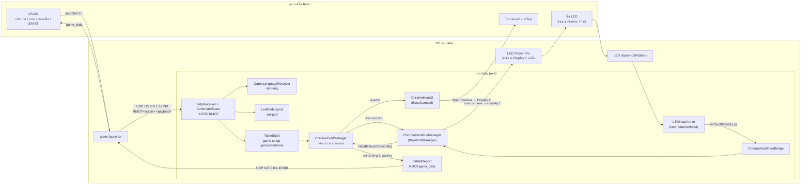
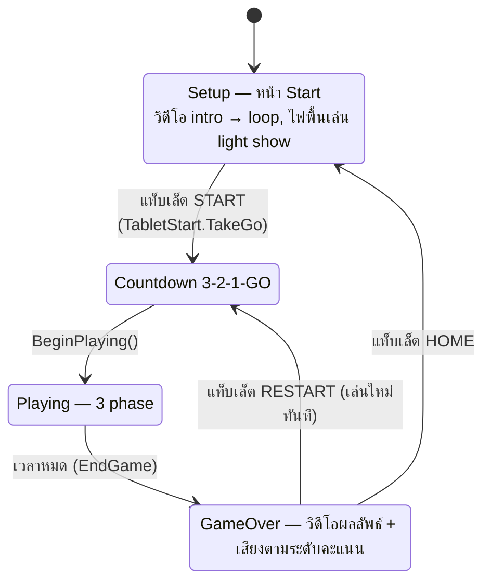
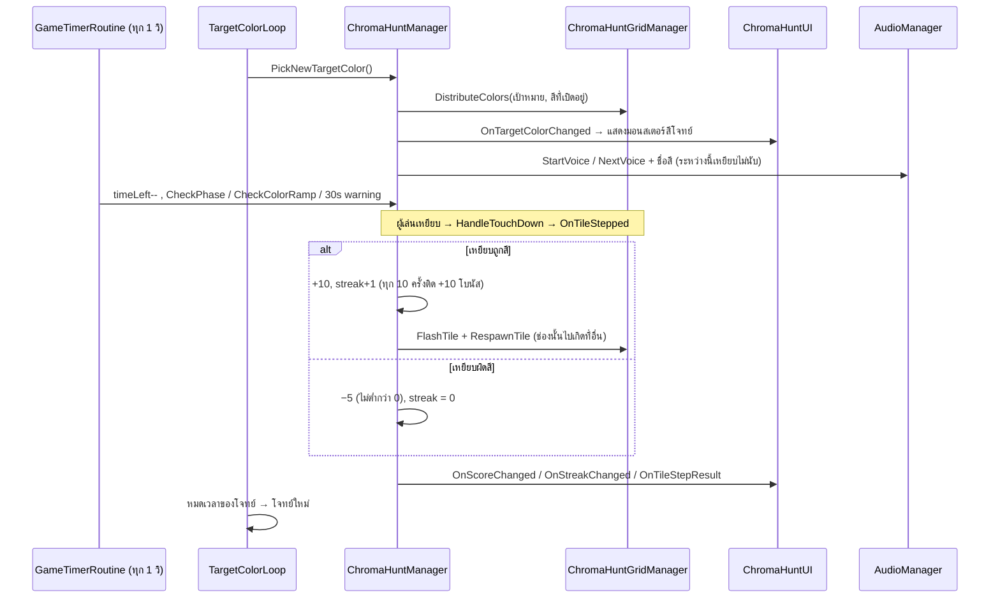
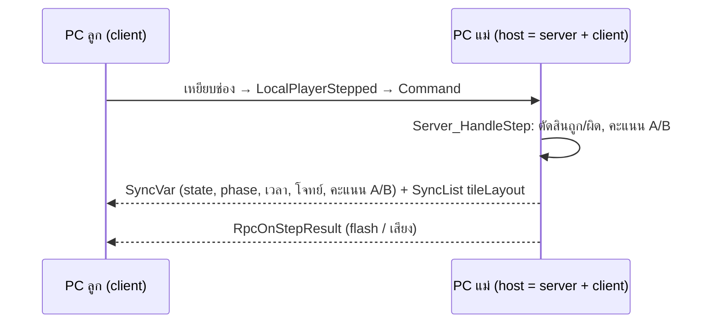

# Color Hunter

เกมเหยียบสีบนพื้น LED ของ Fortal casual lane game: จอแสดงสีโจทย์ ผู้เล่นต้องเหยียบช่องบนพื้นที่เป็นสีนั้นให้ได้มากที่สุดก่อนหมดเวลา

repo นี้แยกเฉพาะ Color Hunter ออกมาจากโปรเจครวม `casual-game` (20 เกม, GitLab `fortalndf/casual-game`) ให้อ่านโค้ดและเปิดเล่นใน Unity ได้
ข้างในมีตัวเกม, ระบบกลางที่ทุกเกมใช้ร่วมกัน และโหมดสองเครื่อง (Mirror) เกมอื่นและ Boot scene ไม่ได้ใส่มา

> ที่มา: `casual-game` working tree วันที่ 2026-11-12 (Color Hunter V3 re-graphic)
> โค้ดฉบับจริงยังอยู่ที่ `casual-game` — แก้ที่นี่จะไม่ไหลกลับไปเอง

---

## 1. เปิดโปรเจค

| ต้องมี | หมายเหตุ |
|---|---|
| **Unity 6000.0.47f1** | เวอร์ชันนี้ตรงๆ (URP 17) |
| **Git LFS** | วิดีโอ `.mp4` และเสียง `.wav/.mp3` อยู่ใน LFS — ไม่มีจะได้ไฟล์เปล่า |
| สิทธิ์ GitLab `fortalndf/led-input-unity` และ `fortalndf/led-floor-applauncher-remote` | Unity ดึง package `com.fortal.*` จากสอง repo นี้ (ดู `Packages/manifest.json`) ถ้าไม่มีสิทธิ์จะ resolve package ไม่ได้ |

```
git lfs install
git clone https://github.com/Thanapat-Sut/color-hunter.git
```
Unity Hub > Add > เลือกโฟลเดอร์ `color-hunter` แล้วเปิด `Assets/Scenes/Color_Hunter.unity`

### เล่นใน Editor (ไม่มีพื้น LED ก็ได้)
- Game view มี 2 display: **Display 1** = ภาพพื้น LED (`GridCamera`), **Display 2** = จอโปรเจคเตอร์ (`Main Camera`) เปิด Game view สองอันตั้งคนละ display
- **คลิกเมาส์ที่ช่องบน Display 1 = เหยียบช่องนั้น**
- ปุ่ม START ปกติมาจากแท็บเล็ต จำลองได้จาก PowerShell ระหว่าง Play (ส่งตอนหน้า Start พร้อมแล้ว):
  ```powershell
  $u = New-Object Net.Sockets.UdpClient
  $b = [Text.Encoding]::UTF8.GetBytes('RMOTgame-setup {"step":"go"}')   # "restart" = เล่นใหม่, "home" = กลับหน้า Start
  $u.Send($b, $b.Length, '127.0.0.1', 19790) | Out-Null
  ```
- **F7** สลับภาษา TH/EN (Editor เท่านั้น)
- เมนู `Casual Game > Color Hunter > UI Version > Old (V2) / New (V3)` สลับชุด UI เก่า/ใหม่ใน scene

---

## 2. ระบบ casual lane game (ภาพรวมทั้ง lane)

หนึ่ง **lane** = PC หนึ่งเครื่องที่รันเกมหนึ่งเกม ต่อกับพื้น LED, โปรเจคเตอร์ และแท็บเล็ตของ lane นั้น



| ส่วน | ไฟล์ | ทำอะไร |
|---|---|---|
| รับคำสั่งแท็บเล็ต | `UdpReceiver` / `CommandEvent` (package `com.fortal.udp` / `tcp` อยู่ใน scene) | ฟัง UDP `19790` ข้อความ `RMOT<action> <payload>` |
| ภาษา | `Scripts/Shared/GameLanguage.cs`, `GameLanguageReceiver.cs`, `LocalizedText.cs` | `set-lang en/th` ครั้งแรกแล้วล็อก, ข้อความบนจอเปลี่ยนตาม |
| ขนาดพื้น | `Scripts/Shared/LedGridLayout.cs` | `set-grid 5x34` → พื้น 10×16 / 10×17 / 10×20 |
| START / RESTART | `Scripts/Shared/TabletStart.cs` | `game-setup {"step":"go"\|"restart"\|"home"}` → `TakeGo()` / `TakeRestart()` / `TakeHome()` |
| รายงานกลับแท็บเล็ต | `Scripts/Shared/TabletReport.cs` | `RMOTgame_data {json}` → UDP `19780` ให้แท็บเล็ตรู้ว่าเกมอยู่หน้าไหน |
| input จากพื้น | `LEDInputArtnet` → `Scripts/ChromaHunt/ChromaHuntFloorBridge.cs` | พิกัดจริง (physX, physY) → `BaseGridManager.OnDebugTouchDown` |
| ตาราง LED | `Scripts/Shared/BaseGridManager.cs` | สร้างช่อง, แปลงพิกัด serpentine (แถบ LED พับครึ่ง: 5×34 จริง = 10×17 ที่เห็น) |
| เสียง | `Scripts/Managers/AudioManager.cs` | เพลง / SFX / voice ตามชื่อ key, เสียงพากย์มี TH + EN |
| วิดีโอหน้า Start | `Scripts/Shared/BaseGameUI.cs`, `VideoLoop.cs` | intro clip → loop clip |
| ไฟบนพื้นตอนว่าง | `Scripts/Shared/FloorShowPatterns.cs`, `FloorShowRunner.cs` | light show ตอนหน้า Start / Game Over |
| บันทึกการเล่น | `Scripts/Replay/ReplaySubmit.cs` | เขียน `ReplayLogs/recordlog_color_hunter_<เวลา>.json` สำหรับตัดคลิปไฮไลต์ |

ในเครื่องจริง exe เปิดที่ `Boot.unity` ก่อน (`Scripts/Shared/BootLoader.cs`: โลโก้ + รอ `set-lang` / `set-grid` แล้วค่อยโหลดเกม) repo นี้ไม่ได้ใส่ Boot scene มา เปิด `Color_Hunter.unity` ตรงๆ ได้เลย

---

## 3. โค้ดของเกม

```
Assets/
├── Scenes/Color_Hunter.unity          scene เดียวของเกม (มี UI ทั้ง V2 และ V3)
├── ScriptableObjects/ColorConfig.asset ค่าที่ปรับได้ทั้งหมด (เวลา, คะแนน, สี)
├── Scripts/ChromaHunt/                โค้ดของ Color Hunter (ชื่อในโค้ด = ChromaHunt)
│   ├── ChromaHuntManager.cs           state machine, เวลา, phase, สีโจทย์, คะแนน, record log
│   ├── ChromaHuntGridManager.cs       วางสีบนพื้น, สลับตำแหน่ง, รับการเหยียบ
│   ├── ChromaHuntTile.cs              ช่องเดียว (สี + index ของสี)
│   ├── ChromaHuntUI.cs                หน้าจอโปรเจคเตอร์: HUD, มอนสเตอร์สีโจทย์, วิดีโอ, ผลลัพธ์
│   ├── ChromaHuntConfig.cs            ชนิดของ ColorConfig.asset
│   ├── ChromaHuntState.cs             ข้อมูลของรอบที่กำลังเล่น
│   ├── ChromaHuntFloorBridge.cs       ต่อ LEDInputArtnet เข้ากับ grid
│   └── ChromaHuntFloatingDots.cs      จุดลอยตกแต่งฉาก
├── Multiplayer/Color_hunt/            โหมดสอง PC (Mirror)
├── Scripts/Shared/                    ระบบกลางของทุกเกม (ตารางด้านบน)
├── Scripts/Managers/                  AudioManager, ScoreManager, GameManager
└── UI/Color Hunt/                     ภาพ, วิดีโอ (LFS)
```

### ลำดับหน้าจอ (state machine)



### ระหว่างเล่น



### กติกา (ค่าจาก `ColorConfig.asset`)

| | Phase 1 | Phase 2 | Phase 3 |
|---|---|---|---|
| ช่วงเวลา (เกม 180 วิ) | 0–30 วิ | 30–120 วิ | 120–180 วิ |
| สีบนพื้น | 2 สี | เพิ่มทีละ 1 สีทุก 45 วิ จนครบ 4 สี | ครบทุกสี |
| เวลาต่อโจทย์ | 12 วิ | 9 วิ | 6 วิ |
| พิเศษ | | | **Stroop**: คำบอกชื่อสีหนึ่งแต่สีที่ต้องเหยียบอีกสี, ไม่มีเสียงบอกสี, เริ่ม phase มีเสียงอธิบายกติกา (นาฬิกาหยุดระหว่างนั้น) |

- สีในเกม: RED, GREEN, BLUE, YELLOW (`gameColors`) ช่องที่มีสี = 30% ของพื้น (`activeTileRatio`) ที่เหลือดำ
- ระหว่างเสียงบอกโจทย์ เหยียบไม่นับคะแนน (`StepsIgnored`) ให้ผู้เล่นได้ยินสีก่อน; Phase 3 ใช้ช่วงคงที่ 1 วิ
- ไม่เริ่มโจทย์ใหม่ถ้าเวลาเกมเหลือน้อยกว่าเวลาต่อโจทย์
- จบเกม: คะแนน ≥ 1000 = `HighVoice`, ≥ 500 = `MidVoice`, ต่ำกว่านั้น `LowVoice`; high score เก็บใน `PlayerPrefs` (`ChromaHunt_HighScore`)

### เสียง (key ใน AudioManager ของ scene)
`ColorMenu` (เพลงหน้า Start), `ColorBGM` (เพลงระหว่างเล่น), `StartVoice` / `NextVoice` + `RedVoice` / `GreenVoice` / ...,
`30sVoice`, `StroopVoice`, `CorrectSFX` / `WrongSFX`, `HighVoice` / `MidVoice` / `LowVoice`, `ClickSFX`

### บันทึกการเล่น (record log)
`ChromaHuntManager` ส่งบรรทัด `[ChromaReplay] type=...` ให้ `ReplaySubmit` (gameId `color_hunter`): `game_start`, `target_changed`,
`step`, `target_end`, `phase_changed`, `colors_added`, `tiles_shuffled`, `stroop_intro`, `game_end` — ใช้หาไฮไลต์และตัดคลิปจาก CCTV

---

## 4. โหมดสองเครื่อง (Multiplayer)

สอง lane ข้างกันเล่นด้วยกันผ่าน Mirror (KCP, UDP 7777) — `Multiplayer/Color_hunt/`


- host เท่านั้นที่กด START ได้, ทุกเครื่องนับถอยหลังพร้อมกัน (`RpcStartGame`)
- server เป็นคนสุ่มสีและวางพื้น เครื่องลูกรับ layout ผ่าน `tileLayout`
- ใน multiplayer ปุ่ม START / Restart ยังอยู่บนพื้น (ใน solo ซ่อน ใช้แท็บเล็ตแทน)
- ต้องเปิด Windows Firewall ขาเข้า UDP 7777 ทั้งสองเครื่อง

---

## 5. สิ่งที่ไม่ได้อยู่ใน repo นี้
- เกมอื่นอีก 19 เกม และ `Boot.unity`
- เครื่องมือ Editor ของเกมอื่น (UI Version ของเกมอื่น, ShapeTracerConfigEditor)
- ตัวอย่างของ Mirror (`Assets/Mirror/Examples`)
- package `com.fortal.*` อยู่ใน GitLab แยก (ดูข้อ 1)
- ช่อง `replayEmail` ใน scene ถูกล้างเป็นค่าว่าง (ไม่ได้ใช้แล้ว)
